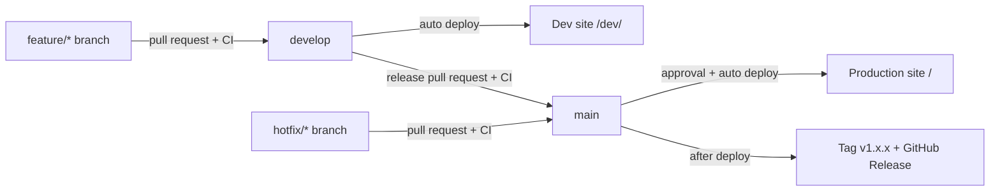

# CI/CD guide for the Lokseva website

This guide explains how the website gets from a change on your laptop to the live site, and why each piece exists. Read it top to bottom once, then use the "How do I..." sections as a reference.

## 1. The big picture

**CI (Continuous Integration)** means every change is checked automatically before it is merged. Here, the checks are `scripts/check.mjs` plus a test build. If a photo is missing, too heavy or misnamed, or the JavaScript is broken, the pull request turns red and cannot be merged.

**CD (Continuous Delivery/Deployment)** means that once a change is merged, it is built and published automatically, the same way every time. Nobody uploads files by hand, so nothing is forgotten and every live version can be traced back to a commit.

**Why bother for a one-page site?** Because the habits are the same ones used on large products: review before merge, test in a safe copy first, release with a version number, and be able to roll back in minutes.



## 2. The two environments

| | Development | Production |
|---|---|---|
| Branch | `develop` | `main` |
| URL | `.../gpt-test/dev/` | `.../gpt-test/` |
| Who it is for | You, checking changes | Customers and the client |
| Search engines | Blocked (`noindex`, robots.txt) | Indexed |
| Badge | Orange "DEV v1.0.0 (commit)" pill | None, version in footer |
| Deploys | Automatically on every merge to `develop` | On merge to `main`, after your approval |

**Why a dev environment?** It is a real, online copy of the site where you can test a change on your actual phone before customers see it. "It worked on my laptop" is not enough; dev is where you find out.

**Why `/dev/` and not a separate domain?** GitHub Pages hosts one site per repository, so both environments live in one site: production at the root, dev in a folder. When the real domain arrives, production moves to it and dev follows at `yourdomain/dev/`. If you later want `dev.yourdomain`, that needs a second Pages site or another host (see section 9).

**What is a GitHub "environment"?** A named target (development, production) that GitHub tracks. Each one shows its deployment history and current URL in the repo sidebar, and can have protection rules such as "a person must approve before deploying". The deploy itself always runs in the special `github-pages` environment, which GitHub requires for Pages.

## 3. The branch model

| Branch | Lives | Purpose |
|---|---|---|
| `main` | forever | Exactly what is in production. Only changed through pull requests. |
| `develop` | forever | Exactly what is on dev. The next release collects here. |
| `feature/<name>` | until merged | One change, for example `feature/whatsapp-link` |
| `hotfix/<name>` | until merged | An urgent production fix that cannot wait for the next release |

Rules the CI enforces on pull requests into `main`:
1. The source must be `develop` or a `hotfix/` branch.
2. `VERSION` must be higher than what is on `main`, and `CHANGELOG.md` must have a section for it.

## 4. What runs when

| You do this | GitHub runs | Result |
|---|---|---|
| Open or update a pull request into `develop` | CI (`ci.yml`) | Green or red check on the pull request |
| Open or update a pull request into `main` | CI + release rules | Same, plus the version and branch checks |
| Merge into `develop` | Deploy (`deploy.yml`) | Dev site updated in about 1 minute |
| Merge into `main` | Deploy, waits for your approval | Production updated, tag and Release created |
| Click "Run workflow" on Deploy | Deploy for that branch | Manual re-deploy |

## 5. The files, one by one

### `site/`
The only folder that is published. Anything outside it (scripts, docs, workflows) never reaches visitors.

### `scripts/check.mjs`
The quality gate. Fails on: invalid `VERSION`, a referenced file that does not exist, a missing product photo, an image over 400 KB or with a double extension like `.jpg.png`, a malformed phone link, a JavaScript syntax error. Warns on: WhatsApp and Instagram placeholders. Its `::error` lines appear as annotations on the pull request, pointing at the file.

### `scripts/build.mjs`
Copies `site/` to an output folder and stamps it:
- `v1.0.0` in the footer, from `VERSION`
- `?v=1.0.0-abc1234` on the CSS and JS links, so browsers fetch new files after each release instead of using a stale cached copy (this is called cache busting)
- Development only: `noindex` and the DEV badge
- Production only: `robots.txt` hiding `/dev/`, and a canonical link once `SITE_URL` is set
- `build-info.json`, so you can open `/build-info.json` and see exactly which version and commit is live

### `.github/workflows/ci.yml`
Runs on pull requests. Job **Site checks and test build** runs the check script and both builds. Job **Release rules for main** runs only for pull requests into `main`. The Deploy workflow reuses this file (`workflow_call`), so the same checks guard every deploy.

### `.github/workflows/deploy.yml`
Runs on every push to `main` or `develop`. Five jobs, each waiting for the one before (`needs:`):
1. **Checks**: the CI above, again. Never deploy something unchecked.
2. **Build**: checks out `main` into `prod/` and `develop` into `dev/`, builds production into `_site/` and development into `_site/dev/`, and packages `_site/` for Pages.
3. **Approve development/production**: does nothing itself, but runs inside the matching GitHub environment. That is where approvals, history and URLs come from.
4. **Publish to GitHub Pages**: uploads the package. Both environments go live together; the one you did not change is rebuilt from its branch unchanged.
5. **Tag release** (main only): if `VERSION` is new, creates tag `v1.0.0` and a GitHub Release whose notes come from `CHANGELOG.md`.

`concurrency: pages-deploy` makes deploys queue instead of overlapping, so two quick merges cannot publish a half-mixed site.

### `VERSION` and `CHANGELOG.md`
`VERSION` holds one line such as `1.0.0`. Bump it in the release pull request. `CHANGELOG.md` is the human story of each version and becomes the Release notes.

## 6. One-time setup in GitHub settings

Workflows cannot change repository settings, so these are clicks you make once.

1. **Turn on Pages with GitHub Actions as the source**
   Settings > Pages > Build and deployment > Source: **GitHub Actions**.
   *Why:* tells GitHub that our Deploy workflow, not a branch folder, publishes the site.

2. **Allow `develop` to deploy to Pages**
   Settings > Environments > `github-pages` > Deployment branches and tags > add `develop` (keep `main`).
   *Why:* by default only `main` may publish to Pages. Without this, dev deploys are rejected.

3. **Require your approval for production**
   Settings > Environments > `production` (it appears after the first run) > tick **Required reviewers** > add yourself > Save.
   *Why:* a final human check before customers see a change. When a release is waiting, the Actions run shows "Review deployments"; click it and approve.

4. **Protect `main` and `develop`**
   Settings > Branches (or Rules > Rulesets) > add a rule for `main` and one for `develop`: require a pull request before merging, require status checks to pass (choose **Site checks and test build**, and for `main` also **Release rules for main**).
   *Why:* makes the process impossible to skip by accident, even for you.

## 7. How do I... make a change

```bash
git checkout develop
```

```bash
git pull
```

```bash
git checkout -b feature/whatsapp-link
```

Edit files in `site/`, then check and preview locally:

```bash
node scripts/check.mjs
```

```bash
node scripts/build.mjs --env development --out _site
```

```bash
python3 -m http.server 8000 -d _site
```

Commit and push:

```bash
git add -A
```

```bash
git commit -m "Add real WhatsApp link"
```

```bash
git push -u origin feature/whatsapp-link
```

On GitHub, open a pull request **into `develop`**. Wait for the green check, merge it, and within a minute or two the change is on the dev site. Check it on your phone.

## 8. How do I... release to production

1. On `develop` (via a small feature pull request, or directly in the release pull request), bump `VERSION`, for example `1.0.0` to `1.1.0`, and move the notes from `[Unreleased]` into a new `## [1.1.0] - date` section in `CHANGELOG.md`.
2. Open a pull request from **`develop` into `main`**, titled "Release v1.1.0".
3. CI runs the checks and the release rules. Merge when green.
4. The Deploy run pauses at **Approve production**. Open it, click **Review deployments**, approve.
5. Production updates, then **Tag release** creates `v1.1.0` with your changelog as notes.

## 9. How do I... fix production urgently (hotfix)

```bash
git checkout main
```

```bash
git pull
```

```bash
git checkout -b hotfix/wrong-phone-number
```

Fix it, bump the PATCH version (1.1.0 to 1.1.1), add a changelog line, push, and open a pull request into `main`. After it is released, merge `main` back into `develop` so the fix is not lost:

```bash
git checkout develop
```

```bash
git merge main
```

```bash
git push
```

## 10. How do I... roll back

**Fastest:** on GitHub, open the pull request that caused the problem and click **Revert**. That creates a new pull request undoing it. Merge it into `main` (with a VERSION bump) and it deploys like any release.

**Re-deploy an older version:** Actions > Deploy > find the last good run on `main` > Re-run all jobs. This rebuilds from whatever `main` is now, so use the revert first if `main` itself is bad.

## 11. Adding the real domain (coming soon)

1. Buy the domain and open its DNS settings.
2. Settings > Pages > Custom domain: enter it (for example `www.lokseva.in`), save. GitHub shows the DNS records to add: a `CNAME` record for `www` pointing to `safishareque.github.io`, and four `A` records for the bare domain.
3. Once DNS works, tick **Enforce HTTPS**.
4. Settings > Secrets and variables > Actions > Variables: add `SITE_URL` = `https://www.lokseva.in`. The next production build adds a canonical link so Google treats the domain as the official address.
5. Update the URLs in `README.md`.

Dev will then be at `https://www.lokseva.in/dev/`. For `dev.lokseva.in` instead, you would host dev separately (a second repository with its own Pages site, or a host such as Cloudflare Pages that supports branch subdomains).

## 12. Glossary

- **Workflow**: a YAML file in `.github/workflows/` that GitHub runs on events.
- **Job**: a group of steps that runs on a fresh virtual machine. `needs:` orders jobs.
- **Step**: one command (`run:`) or one reusable action (`uses:`).
- **Action**: a published building block, such as `actions/checkout@v4`. The `@v4` pins the version so updates cannot surprise you.
- **Runner**: the virtual machine that runs a job (`ubuntu-latest`).
- **Artifact**: a file bundle a job produces and passes on, here the packaged site.
- **Environment**: a named deploy target with history, URL and protection rules.
- **Status check**: the green tick or red cross a workflow puts on a pull request.
- **Semantic versioning**: MAJOR.MINOR.PATCH, see `CHANGELOG.md`.

## 13. Practice exercises

1. Make a feature branch that changes the hero subtitle, open a pull request into `develop`, and watch CI run.
2. Upload a photo named `test.jpg.png` in a feature branch and see CI block it. Then delete it.
3. Release `1.0.1` with your subtitle change: bump `VERSION`, update `CHANGELOG.md`, pull request `develop` into `main`, approve the production deploy, and find the new Release on the repo page.
4. Open a pull request from a feature branch straight into `main` and read why CI refuses it.
